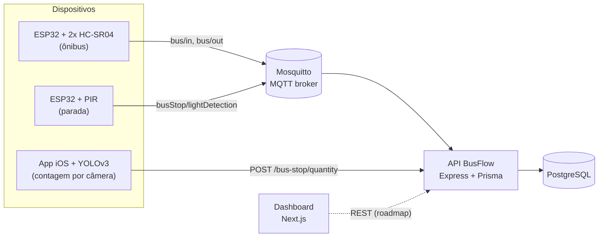
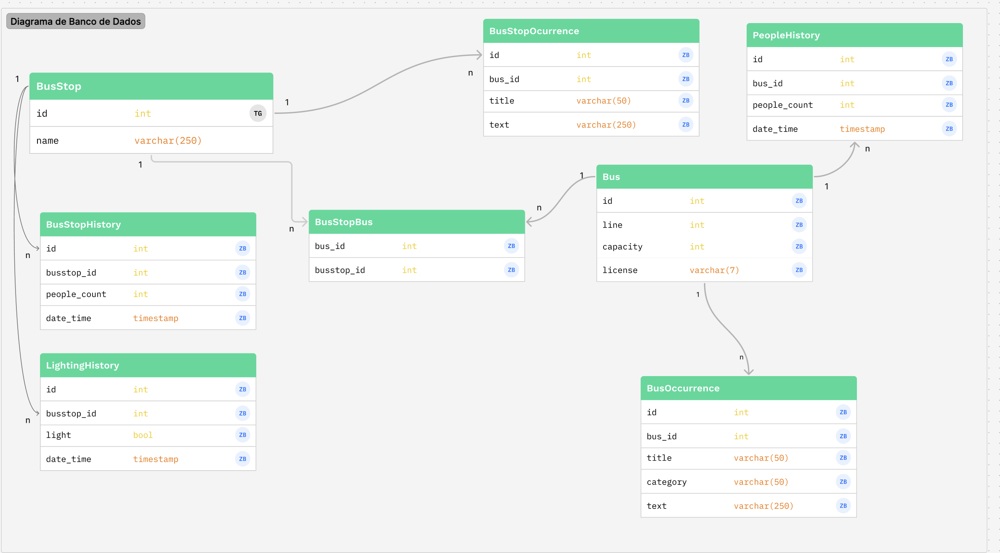

# BusFlow — Monitoramento Inteligente de Transporte Público

O **BusFlow** é um protótipo IoT que mede, em tempo real, a ocupação de ônibus e de paradas.
Sensores conectados a ESP32 detectam entradas/saídas de passageiros e presença nas paradas,
publicam eventos via **MQTT** e uma API **Node.js/TypeScript** persiste o histórico em **PostgreSQL**.

## Arquitetura



| Componente | Pasta | Tecnologias |
|---|---|---|
| Contador de passageiros | [`ESP_2Sonares_Onibus/`](ESP_2Sonares_Onibus) | ESP32, 2× HC-SR04, NTP, MQTT |
| Detector de presença na parada | [`ESP_PIR_Parada/`](ESP_PIR_Parada) | ESP32, sensor PIR, LED, MQTT |
| Teste do display | [`ESP_screen/`](ESP_screen) | ESP32, OLED SSD1306 |
| API | [`BusFlow/`](BusFlow) | Node.js, TypeScript, Express 5, Prisma, MQTT.js |
| Dashboard web | [`busflow-front/`](busflow-front) | Next.js 15, React 19, Tailwind CSS 4 |
| App de câmera | [`BusFlowCameraApp/`](BusFlowCameraApp) | Swift, UIKit/SwiftUI, Vision, Core ML (YOLOv3) |

### Como funciona a contagem

- **Ônibus:** um sensor ultrassônico fica na porta de entrada e outro na de saída. Quando algo passa a
  menos de 30 cm, o ESP32 publica um evento **apenas na borda de subida** da detecção, evitando contar
  a mesma pessoa várias vezes. Cada evento leva o `busId` e um timestamp ISO 8601 em UTC (via NTP).
- **API:** cada evento gera um **novo registro** em `PeopleHistory` com a contagem anterior ±1
  (nunca negativa), dentro de uma transação — o histórico completo de ocupação é preservado.
- **Parada:** o PIR é lido a cada 5 s; o estado é refletido no LED e salvo em `LightingHistory`.
  O app iOS conta pessoas na imagem com YOLOv3 e envia a quantidade a cada 3 s.

## Modelo de dados



O schema completo está em [`BusFlow/prisma/schema.prisma`](BusFlow/prisma/schema.prisma).

## Como executar

### Pré-requisitos

- Node.js 18+
- PostgreSQL 14+
- [Mosquitto](https://mosquitto.org/) 2.x
- Arduino IDE (ou arduino-cli) com o core **ESP32** instalado
- Xcode (opcional, para o app iOS)

### 1. Broker MQTT

```bash
cd BusFlow
mosquitto -c mosquitto.conf -v
```

### 2. API

```bash
cd BusFlow
cp .env.example .env          # ajuste DATABASE_URL e MQTT_HOST
npm install
npx prisma migrate deploy     # cria as tabelas
npm run dev                   # http://localhost:8888
```

Scripts disponíveis: `dev`, `build`, `start`, `typecheck`, `prisma:generate`, `prisma:migrate`.

### 3. Dashboard

```bash
cd busflow-front
npm install
npm run dev                   # http://localhost:3000
```

### 4. Firmware (ESP32)

As credenciais **não ficam no código**. Em cada sketch:

```bash
cp ESP_2Sonares_Onibus/secrets.example.h ESP_2Sonares_Onibus/secrets.h
cp ESP_PIR_Parada/secrets.example.h      ESP_PIR_Parada/secrets.h
```

Preencha `WIFI_SSID`, `WIFI_PASSWORD` e `MQTT_SERVER` (IP da máquina que roda o Mosquitto).
O `secrets.h` está no `.gitignore`. Ajuste também `BUS_ID` / `BUS_STOP_ID` no topo do `.ino`
para corresponder aos registros criados na API.

Bibliotecas necessárias (instale pelo Library Manager):

| Biblioteca | Usada em |
|---|---|
| PubSubClient (Nick O'Leary) | sonares, PIR |
| NTPClient (Fabrice Weinberg) | sonares |
| Adafruit SSD1306 + Adafruit GFX | display |

### 5. App iOS (opcional)

Baixe o modelo `YOLOv3FP16.mlmodel` da [galeria de modelos Core ML da Apple](https://developer.apple.com/machine-learning/models/)
para `BusFlowCameraApp/BusFlowCameraApp/` (o arquivo não é versionado por ser grande) e ajuste o
IP da API em `CameraController.swift`.

## API REST

Todas as respostas são JSON. Erros seguem o formato `{ "error": "mensagem" }` com status 400/404/500.

| Método | Rota | Descrição | Corpo / query |
|---|---|---|---|
| GET | `/health` | Health check | — |
| GET | `/bus` | Lista ônibus com histórico de ocupação | — |
| POST | `/bus` | Cria ônibus | `{ line, capacity, license }` |
| PUT | `/bus/:id` | Atualiza ônibus | `{ line?, capacity?, license? }` |
| DELETE | `/bus/:id` | Remove ônibus | — |
| GET | `/bus/quantity` | Ocupação atual do ônibus | `?busId=1` |
| POST | `/bus/in` | Registra entrada | `{ busId, date? }` |
| POST | `/bus/out` | Registra saída | `{ busId, date? }` |
| GET | `/bus-stop` | Lista paradas com histórico | — |
| POST | `/bus-stop` | Cria parada | `{ name, latitude, longitude }` |
| PUT | `/bus-stop/:id` | Atualiza parada | `{ name?, latitude?, longitude? }` |
| DELETE | `/bus-stop/:id` | Remove parada | — |
| GET | `/bus-stop/quantity` | Última contagem da parada | `?busStopId=1` |
| POST | `/bus-stop/quantity` | Registra contagem (app de câmera) | `{ busStopId, quantity }` |
| POST | `/bus-stop/lightDetection` | Registra presença (PIR) | `{ busStopId, detection }` |

> Por compatibilidade, `PUT`/`DELETE` também aceitam o id no corpo (`id` para ônibus, `busStopId` para paradas).

### Tópicos MQTT

| Tópico | Publicado por | Payload |
|---|---|---|
| `bus/in` | ESP32 sonares | `{"busId": 3, "date": "2025-05-20T10:00:00.000Z"}` |
| `bus/out` | ESP32 sonares | `{"busId": 3, "date": "2025-05-20T10:00:00.000Z"}` |
| `busStop/lightDetection` | ESP32 PIR | `{"busStopId": 4, "detection": true}` |

A API se inscreve nesses tópicos e chama os casos de uso diretamente; mensagens malformadas são
registradas no log e descartadas sem derrubar o servidor.

## Estrutura do projeto

```
BusFlow-ESP32/
├── ESP_2Sonares_Onibus/      # Firmware: contagem de passageiros
├── ESP_PIR_Parada/           # Firmware: presença na parada
├── ESP_screen/               # Firmware: teste do display OLED
├── BusFlow/                  # API
│   ├── prisma/               # Schema e migrations
│   └── src/
│       ├── config/           # Leitura de variáveis de ambiente
│       ├── modules/
│       │   ├── hardware/mqtt # Cliente MQTT e handlers dos tópicos
│       │   └── software/     # Controllers e services (CRUD + casos de uso)
│       ├── shared/           # Erros e validação
│       ├── routes.ts
│       └── server.ts
├── busflow-front/            # Dashboard Next.js
├── BusFlowCameraApp/         # App iOS
└── docs/                     # Diagramas
```

## Limitações conhecidas e roadmap

- [ ] Dashboard consumir a API (hoje usa dados mockados)
- [ ] Autenticação na API e no broker MQTT (hoje `allow_anonymous`, adequado apenas para rede local)
- [ ] Testes automatizados e CI
- [ ] Docker Compose com PostgreSQL + Mosquitto + API
- [ ] Mostrar a ocupação no display OLED do ônibus

## Autores

- **Gabriel Cortez** — [@gabrielcortezspr](https://github.com/gabrielcortezspr)
- **Ítalo Monte** — [@italomonte](https://github.com/italomonte)

## Licença

Distribuído sob a licença MIT. Veja [LICENSE](LICENSE).
